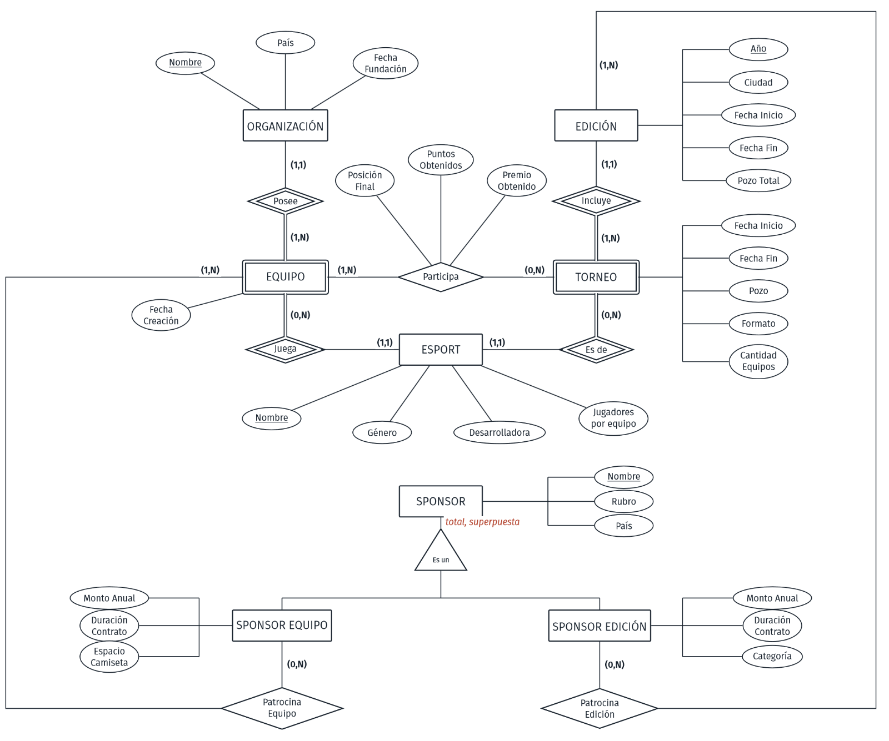

# Esports World Cup Database
### Modelo relacional en PostgreSQL

Una base de datos para seguir la Esports World Cup: ediciones, torneos, equipos, organizaciones, premios y sponsors. El trabajo va desde el modelo conceptual hasta las tablas, los permisos por tipo de usuario y las consultas.

**García, González, Puentes y Turkie** · Bases de Datos, UdeSA · septiembre de 2026

[Informe con el modelo y las decisiones de diseño](informe.pdf) · [Guía de ejecución](COMO_EJECUTAR.md)

**Resultado:** una base con 12 tablas, 4 perfiles de usuario y datos reales de tres ediciones, lista para consultar.

## Decisiones de diseño

- **Torneo y Equipo son entidades débiles.** "El torneo de League of Legends" no identifica nada hasta que se dice de qué edición; "el equipo de G2", hasta que se dice de qué juego. Cada uno depende de dos entidades.
- **Sponsor se especializa** en sponsor de edición y sponsor de equipo. Es una especialización total y superpuesta: un mismo sponsor puede patrocinar una edición y equipos a la vez, con montos distintos en cada caso.
- **El diagrama de Sponsor se rehízo.** Al principio era una sola entidad con los montos repetidos en dos relaciones; la especialización resolvió esa duplicación.
- **El puntaje total de una organización no se guarda**: se calcula a partir de sus participaciones, para que nunca contradiga los datos que lo originan.

## Qué contiene

- 12 tablas con claves y restricciones de integridad.
- Cuatro roles con permisos distintos: administración, organizaciones, sponsors y prensa. Por ejemplo, prensa consulta resultados pero no ve los montos de los contratos.
- 12 consultas con joins, agregaciones y subconsultas.
- Un generador en Python que arma los datos a partir de Liquipedia y de datos complementarios del equipo.

Los datos cubren tres ediciones (2024–2026), tres esports, nueve torneos, 40 organizaciones, 47 equipos y 72 participaciones. Es una selección histórica, no una actualización en vivo.

Una de las consultas, la clasificación de organizaciones por puntos y premios acumulados:

~~~sql
SELECT o.nombre_org,
       o.pais,
       COUNT(*)        AS participaciones,
       SUM(tp.puntos)  AS puntos_totales,
       SUM(tp.premio)  AS premio_total
FROM participaciones p
JOIN organizaciones o ON p.nombre_org = o.nombre_org
JOIN tabla_puntos tp
  ON  p.anio_edicion   = tp.anio_edicion
  AND p.nombre_esport  = tp.nombre_esport
  AND p.posicion_final = tp.posicion_final
GROUP BY o.nombre_org, o.pais
ORDER BY puntos_totales DESC;
~~~

## Conclusión

Lo más valioso fue resolver las reglas en el propio modelo en lugar de confiar en quien carga los datos. Que un equipo solo participe en torneos de su esport, por ejemplo, queda garantizado por la estructura de las tablas. Y varios supuestos que parecían obvios hubo que comprobarlos contra los datos reales de la competencia.

## Crear y consultar la base

Usar una **instancia de PostgreSQL de práctica**: los scripts recrean tablas y roles, y los roles afectan a todo el clúster. Las contraseñas del SQL son ejemplos locales.

~~~sh
createdb -U postgres ewc
psql -U postgres -d ewc -v ON_ERROR_STOP=1 -f 01_crear_tablas.sql
psql -U postgres -d ewc -v ON_ERROR_STOP=1 -f 02_usuarios_permisos.sql
psql -U postgres -d ewc -v ON_ERROR_STOP=1 -f 03_carga_datos.sql
psql -U postgres -d ewc -v ON_ERROR_STOP=1 -f 04_consultas.sql
~~~

Los datos ya están preparados en **datos/**, junto con la caché y el generador; no hace falta regenerarlos. El [detalle técnico](DOCUMENTACION.md) explica la selección de datos y las comprobaciones de carga.
